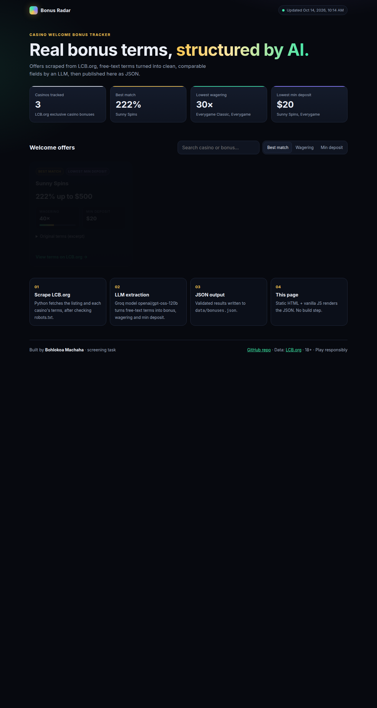

# Casino bonus scraper (screening task)

**Bohlokoa Machaha**

## For reviewers

- **Live page:** https://jah-guide.github.io/casino-bonus-scraper/
- **One-command run** (after install below): `python3 scrape.py`
- **Requirement checklist**
  - [ ] **3 casinos scraped** — `scrape.py` (`CASINO_COUNT = 3`) from [LCB.org exclusive bonuses](https://lcb.org/bonuses/exclusive); robots check in `data/robots_lcb_org.txt` (`can_fetch_source: true` in JSON)
  - [ ] **Structured JSON** — `data/bonuses.json` (+ copy at `docs/data/bonuses.json` via `scripts/build_docs.py`)
  - [ ] **LLM extraction (Groq)** — `extract_with_llm()` in `scrape.py`; committed run used `openai/gpt-oss-120b` (`llm` block in JSON)
  - [ ] **Public, mobile-friendly page** — `docs/index.html` (responsive CSS, no build step; GitHub Pages `/docs`)
  - [ ] **Production plan (200 casinos / day)** — section below + longer draft in `PRODUCTION_NOTES_DRAFT.md`
  - [ ] **AI usage** — “How I used AI” section below



I built a small Python scraper and a static **Bonus Radar** dashboard that turns three real welcome offers into comparable fields, then publishes them as JSON for GitHub Pages.

**Latest extracted output** (`data/bonuses.json`, generated 2026-10-14):

| Casino | Welcome bonus | Wagering | Min deposit |
|--------|---------------|----------|-------------|
| Sunny Spins | 222% up to $500 | 40× | $20 |
| Everygame Classic | 200% up to $200 + 50 Spins | 30× | $30 |
| Everygame | 200% up to $2000 + 100 Spins | 30× | $20 |

**Source:** [LCB.org exclusive bonuses](https://lcb.org/bonuses/exclusive). I fetch [robots.txt](https://lcb.org/robots.txt) first; the saved copy shows the list URL is allowed to crawl.

**LLM:** Groq OpenAI-compatible API, model `openai/gpt-oss-120b` (see `llm` in `data/bonuses.json`).

## Setup

```bash
python3 -m venv .venv
source .venv/bin/activate
pip install -r requirements.txt
export LLM_API_KEY="gsk_..."   # Groq; or see env table below
```

## Run

```bash
python3 scrape.py
```

Rebuild only the site copy of the JSON:

```bash
python scripts/build_docs.py
```

Preview the page:

```bash
python3 -m http.server 8765 --directory docs
```

Open http://127.0.0.1:8765/

| Variable | Purpose |
|----------|---------|
| `LLM_API_KEY` | Groq API key (default when set and `LLM_BASE_URL` is unset) |
| `OPENAI_API_KEY` | OpenAI; use with `LLM_PROVIDER=openai` |
| `LLM_PROVIDER` | `openai` to force OpenAI |
| `LLM_MODEL` | Override model (Groq default: `openai/gpt-oss-120b`) |
| `LLM_BASE_URL` | Override API base (Groq default: `https://api.groq.com/openai/v1`) |

Without an API key the scraper still writes JSON using regex fallbacks on scraped text (`llm.ran: false`); exit code `1` in that case.

## What the code does

1. Saves `https://lcb.org/robots.txt` to `data/robots_lcb_org.txt`.
2. Scrapes three deposit-style rows from the exclusive list, then loads terms from each casino page.
3. Calls the LLM for `welcome_bonus`, `wagering_requirement_multiplier`, and `minimum_deposit`.
4. Writes `data/bonuses.json` and copies it to `docs/data/bonuses.json`.

## Production plan (200 casinos, daily)

For a daily refresh at scale I would:

- **Schedule:** cron at **04:00 UTC** on a **Hetzner VPS (~€5/month)** or **GCP Cloud Run Jobs** (scale-to-zero).
- **Data:** **Supabase Postgres** for casinos, scrape runs, and bonus snapshots; **daily backups** plus a **weekly logical export** to object storage.
- **Site:** **Cloudflare Pages** in front of the static JSON export, with **DNS and HTTPS** on Cloudflare.
- **Reliability:** fail the job and **alert (email/Slack)** on HTTP block, schema validation failure, or **<95%** of casinos parsed; **hash terms** and send **only changed text** to the LLM.
- **Cost:** roughly **R200–R800/month** depending on VPS vs managed DB and LLM token use (see `PRODUCTION_NOTES_DRAFT.md` for a fuller breakdown).

## How I used AI

- I built and iterated on this repo with **Cursor AI agents** (scraper, JSON schema, and the Bonus Radar page).
- My first bonus source returned **N/A**, so I switched to **LCB.org** (static HTML + allowed robots).
- While validating output I caught a stray **`$20.`** full stop in a minimum-deposit field and fixed the parsing/prompt path.
- Groq’s earlier default model was **retired**, so I updated the default to **`openai/gpt-oss-120b`**.
- I checked the final extracted values in `data/bonuses.json` against the source terms on LCB.org by hand.

## Time spent

About **1.5 hours**.

## Known gaps

- Only **3 casinos** from **one listing page** (screening scope).
- No **scheduler**, **database**, or **monitoring** in this repo yet—just the scraper, JSON, and static site.
